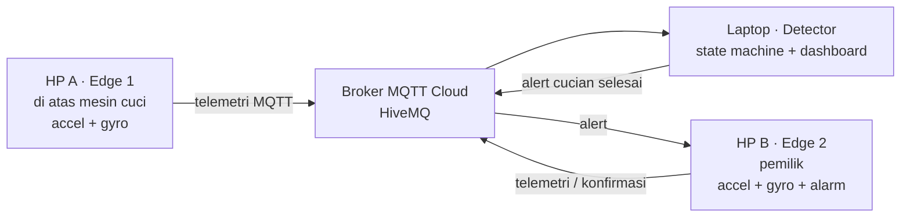
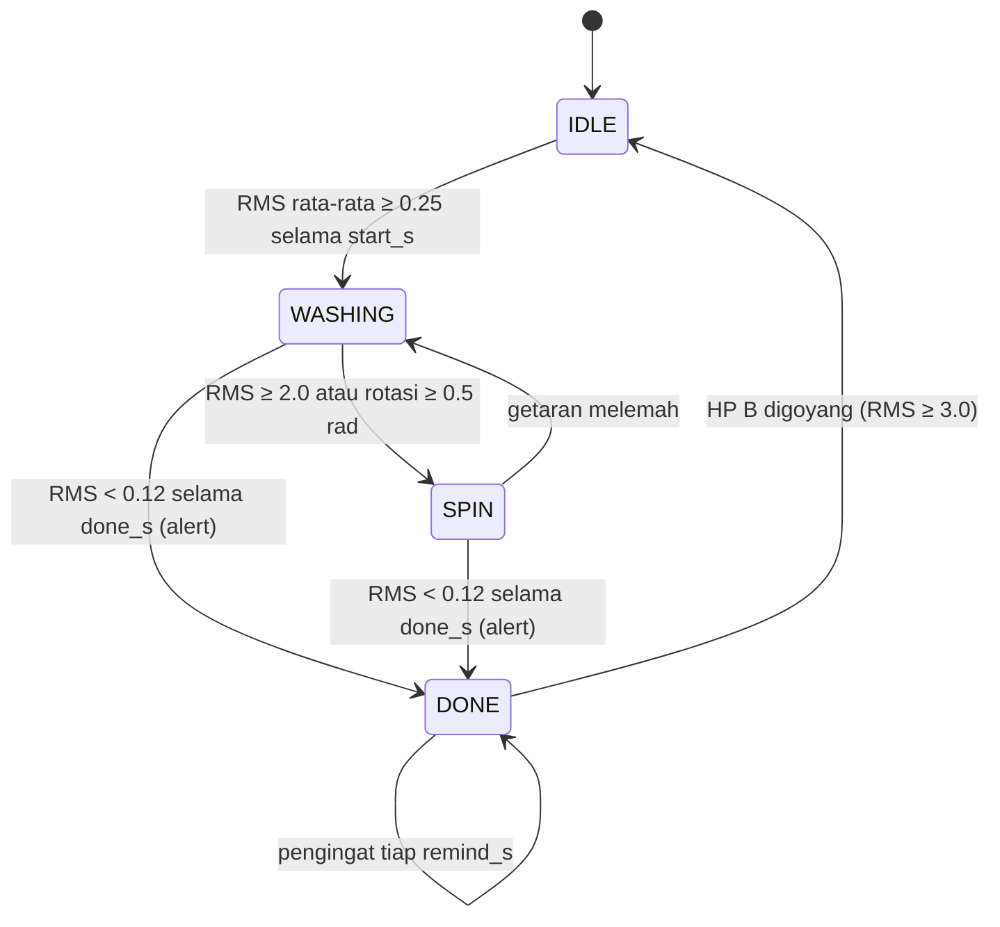

# WashAlert — Notifikasi Mesin Cuci Selesai

**Masalah:** di kos/laundry bersama, mesin cuci sering selesai tanpa ada yang tahu. Cucian jadi apek karena kelamaan di tabung, dan antrean mesin macet.

**Ide:** HP A ditaruh di atas mesin cuci dan membaca getarannya. Saat mesin berhenti setelah sempat bekerja, HP B milik pemilik bergetar dengan notifikasi *"Cucian selesai!"* dan terus mengingatkan sampai pemilik **menggoyang HP B** sebagai tanda konfirmasi.

## Kesesuaian dengan ketentuan tugas

| Ketentuan | Di WashAlert |
|---|---|
| 2 edge device | HP A (di atas mesin cuci) dan HP B (pemilik) |
| 2 sensor | Accelerometer + gyroscope di setiap HP |
| 2+ data processing | Di edge: **A.** RMS getaran, **B.** total rotasi (integrasi gyro). Di detector: **C.** moving average RMS, **D.** timer durasi getar/diam + lama mesin bekerja |
| Algoritma | Finite state machine `IDLE → WASHING ⇄ SPIN → DONE` dengan threshold + hysteresis + syarat durasi |
| Protokol ke cloud | MQTT over TLS ke broker publik HiveMQ |
| Komunikasi 2 arah | HP → cloud (telemetri), cloud → HP B (alert), HP B → cloud (konfirmasi dengan menggoyang HP) |
| Dashboard (opsional) | `localhost:8000` di laptop: status, lama mencuci, grafik getaran real-time, tombol ARM/DISARM |

## Arsitektur



## Algoritma (state machine)



- **Syarat durasi** mencegah alarm palsu: HP tersenggol sekali tidak dianggap mulai mencuci, dan jeda singkat di tengah siklus tidak dianggap selesai.
- **Hysteresis** (ambang mulai 0.25, ambang diam 0.12) mencegah status berkedip-kedip di sekitar satu nilai ambang.
- Mode waktu diatur di `.env` lewat `CUCI_MODE`:
  - `demo` (default): start 6 dtk, done 8 dtk, pengingat 20 dtk. Cocok untuk video demo.
  - `real`: start 60 dtk, done 120 dtk, pengingat 5 menit. Untuk mesin cuci sungguhan.
  - Semua ambang bisa diubah: `CUCI_WASH_TH`, `CUCI_STILL_TH`, `CUCI_SPIN_TH`, `CUCI_SPIN_ROT`, `CUCI_ACK_TH`.

## Struktur kode

| File | Peran |
|---|---|
| `hp_mesin.py` | NODE 1: HP A (edge1) |
| `hp_pemilik.py` | NODE 2: HP B (edge2) + alarm |
| `detector.py` | NODE 3: laptop, detector + dashboard |
| `nodes/detector_service/rules.py` | **Algoritma state machine** + processing C & D |
| `nodes/detector_service/main.py` | Jembatan MQTT ↔ algoritma |
| `shared/processing.py` | Processing A (RMS) & B (rotasi) di edge |
| `shared/sensors.py` | Baca sensor Termux:API / simulator |
| `shared/alarm.py` | Getar + notifikasi di HP B |
| `dashboard/index.html` | Dashboard web |
| `scripts/offline_demo.py` | Demo algoritma tanpa jaringan |
| `tests/` | Unit test |

## Cara menjalankan

### 1. Laptop

```bash
python -m pip install -r requirements.txt
cp .env.example .env        # Windows: Copy-Item .env.example .env
```

Ganti `PROJECT_ID` di `.env` dengan nama unik kelompok kalian. Nilainya harus **sama persis** di laptop dan kedua HP.

```bash
python -m scripts.offline_demo     # cek algoritma dulu (tanpa internet)
python detector.py                 # buka http://localhost:8000
```

### 2. Kedua HP (Termux + Termux:API)

Install Termux dan Termux:API (dari F-Droid), lalu di masing-masing HP jalankan:

```bash
pkg install python termux-api git
git clone <link-repo-kalian> && cd <nama-repo>
pip install -r requirements.txt
cp .env.example .env               # samakan PROJECT_ID
```

- HP A (taruh di atas mesin cuci): `python hp_mesin.py`
- HP B (dipegang pemilik): `python hp_pemilik.py`

Tambahkan `--debug-sensors` untuk melihat nilai mentah sensor. Gunakan ini untuk **kalibrasi threshold**: catat nilai RMS saat mesin diam, saat mencuci, dan saat spin.

### Uji tanpa HP (simulator)

Buka tiga terminal di laptop:

```bash
python detector.py
python hp_mesin.py --source simulator      # 1 siklus: diam → cuci → spin → diam
python hp_pemilik.py --source simulator    # HP B "digoyang" otomatis di detik ke-40
```

Simulator hanya untuk debugging, **tidak dihitung sebagai edge fisik**.

## Skenario demo

1. Kedua HP diam di meja → dashboard menampilkan `IDLE`.
2. Geser-geser HP A pelan selama ±10 detik (seolah mesin mencuci) → `WASHING`.
3. Goyang HP A keras (seolah spin) → `SPIN`.
4. Diamkan HP A ±10 detik → `DONE`, lalu HP B bergetar dan muncul notifikasi.
5. Biarkan 20 detik → HP B bergetar lagi (pengingat).
6. Goyang HP B dengan kuat → kembali ke `IDLE` (konfirmasi pemilik).

Bonus untuk bagian pengujian: taruh HP A di atas mesin cuci sungguhan dengan `CUCI_MODE=real`.

## Pengujian otomatis

```bash
python -m unittest discover -s tests -t .
```

Unit test mencakup:
- satu siklus penuh yang menghasilkan alert **sekali**;
- HP tersenggol sekali tidak memicu `WASHING`;
- jeda singkat tidak dianggap `DONE`;
- pengingat dan konfirmasi dari HP B;
- goyangan HP B diabaikan saat mesin masih mencuci;
- DISARM me-reset siklus;
- penolakan pesan replay dan pesan basi (stale).

---
